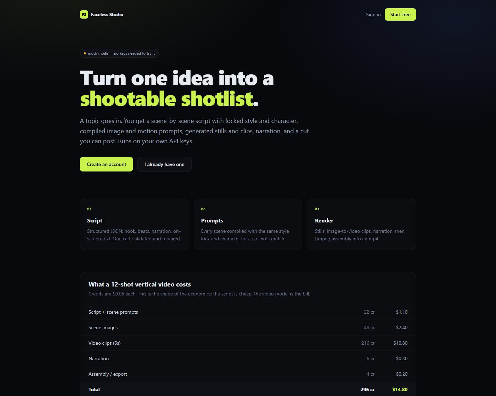
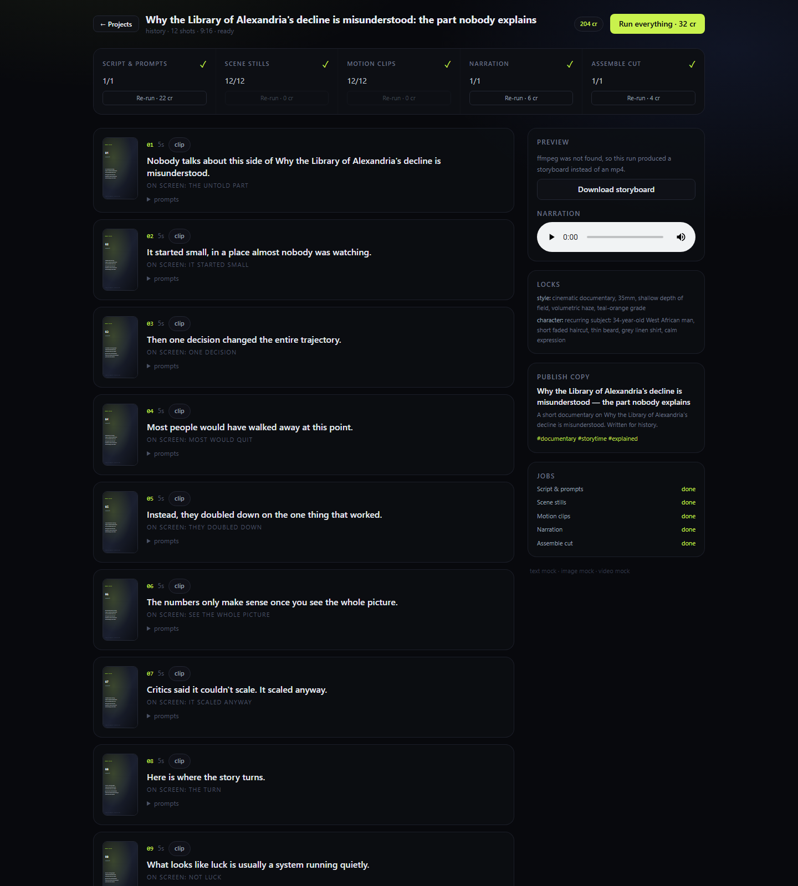
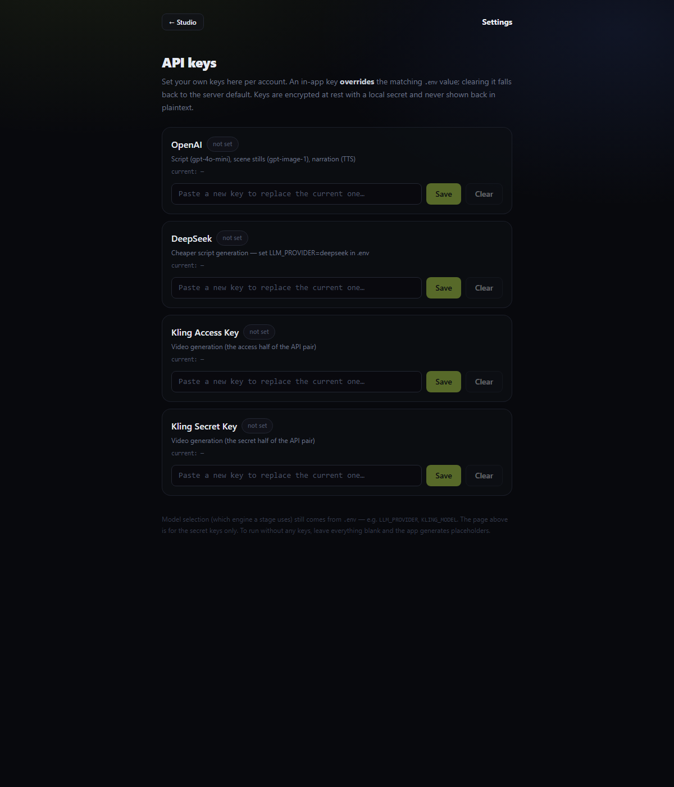

# Faceless Studio

Self-hosted faceless video pipeline: **topic → script → prompts → stills → clips → narration → cut**,
with a credit ledger, a job queue, and provider adapters you own.

It is the thing the subscription sites sell, minus the subscription: the prompt layer is code in
this repo, the keys are yours, and nothing expires.





---

## Quickstart

```bash
npm install
cp .env.example .env      # optional — with no keys it runs fully in mock mode
npm run dev               # http://localhost:3000
```

Create an account (the first one gets 500 free credits), make a project, press
**Run everything**. In mock mode every stage completes with placeholder assets, so you can
exercise the whole flow and the ledger before spending a cent.

For a production run:

```bash
npm run build
npm start
```

### ffmpeg

Assembly needs `ffmpeg` on `PATH` (or set `FFMPEG_PATH`). Without it the assemble stage does not
fail — it exports a **storyboard HTML + shotlist** with every frame, prompt, and timing instead,
which is genuinely useful for reviewing a script before paying for video.

Windows: `winget install Gyan.FFmpeg` · macOS: `brew install ffmpeg` · Debian: `apt install ffmpeg`

---

## API keys

Keys can be set per account in **Settings → API keys**, or globally via `.env`. An in-app key
overrides the matching env value; clearing it falls back to env. Keys are encrypted at rest with
`APP_SECRET` (or a generated `data/secret.key`) and never echoed back in plaintext.

## Modes

| `PROVIDER_MODE` | Behaviour |
| --- | --- |
| `auto` (default) | Each provider goes live only when its key is present. Mix and match. |
| `mock` | Never calls a paid API. Deterministic placeholder assets. |
| `live` | Requires real keys; fails loudly if one is missing. |

The header of the app tells you which providers are live at all times.

---

## Providers

| Stage | Default | Swap for |
| --- | --- | --- |
| Text / script | OpenAI `gpt-4o-mini` | `LLM_PROVIDER=deepseek` (`deepseek-chat`, much cheaper for bulk), or any OpenAI-compatible endpoint via `LLM_PROVIDER=custom` |
| Stills | OpenAI `gpt-image-1` | Flux (fal/Replicate), Imagen — implement `ImageProvider` |
| Motion | Kling AI official API (`kling-v1-6`) | Runway, Veo, Hailuo, Luma — implement `VideoProvider` |
| Narration | OpenAI `gpt-4o-mini-tts` | ElevenLabs, Kokoro — implement `TtsProvider` |
| Assembly | `ffmpeg` | — |

Kling needs an **access/secret pair**, not a bearer key (`KLING_ACCESS_KEY`, `KLING_SECRET_KEY`).
The adapter signs a short-lived HS256 JWT per request, then polls the task and downloads the mp4
locally so nothing depends on a provider URL surviving.

Every adapter is ~40 lines and sits behind an interface in `src/lib/providers/types.ts`, so adding
a vendor means writing one class and one line in `providers/index.ts`.

### Narration: OpenAI or self-hosted VoiceStudio

Narration is one adapter, because OpenAI and [VoiceStudio](https://github.com/debpalash/VoiceStudio)
share the same `POST /v1/audio/speech` contract. Switch backends with one env var:

```bash
TTS_PROVIDER=voicestudio
VOICESTUDIO_URL=http://127.0.0.1:3900
VOICESTUDIO_API_KEY=<the OMNIVOICE_API_KEY the service was started with>
VOICESTUDIO_MODEL=omnivoice      # or voxcpm2 / cosyvoice / kittentts
VOICESTUDIO_VOICE=default        # or a voice profile id/name
```

VoiceStudio is a full self-hosted service, not a library: it needs its own container, ~2.4 GB of
model weights on first run, and CPU or GPU for inference. `docker-compose.yml` wires both services
together for a VPS:

```bash
export APP_SECRET="$(openssl rand -hex 32)"
export OMNIVOICE_API_KEY="$(openssl rand -hex 32)"
docker compose up -d --build
```

Notes:

- Long narration is chunked at sentence boundaries (both providers cap `input` at 4096 chars), and
  the WAV chunks are re-stitched under a single valid header.
- VoiceStudio is AGPL-3.0. It runs as a separate service and is only reached over its HTTP API.
- On CPU, synthesis is slower than real time — fine for batch renders, not for live preview.
- Leaving `TTS_PROVIDER` unset keeps OpenAI behaviour; VoiceStudio is strictly opt-in.

---

## How it works

```
topic
  └─ script job ──► LLM returns strict JSON (hook, beats, per-scene narration + prompts)
                     validated → repaired → scenes table
  └─ images job ──► compileImagePrompt(scene)   → provider → asset row
  └─ videos job ──► compileVideoPrompt(scene)   → provider (image-to-video) → asset row
  └─ tts job    ──► all narration lines         → one continuous track
  └─ assemble   ──► ffmpeg filter graph (stills + clips + audio) → mp4
```

The two ideas that make output look consistent:

1. **Style lock + character lock** are generated once and pasted *verbatim* into every prompt.
   `compileImagePrompt()` / `compileVideoPrompt()` in `src/lib/script.ts` enforce this — scenes can
   never drift because a model re-worded the description.
2. **Scenes are idempotent.** Every stage only fills what is missing, so a failed provider run costs
   nothing extra to resume, and re-running a finished stage is a free no-op.

### Layout

```
src/app/                 routes + pages (Next.js App Router)
  api/auth/*             signup / login / logout (scrypt + cookie session)
  api/projects/*         create, snapshot, generate
  api/assets/[id]        asset streaming (nosniff, HTML forced to download)
src/lib/db.ts            SQLite schema (WAL) — users, sessions, projects, scenes, jobs, ledger, assets
src/lib/credits.ts       pricing + append-only ledger
src/lib/pipeline.ts      stage costing, batch charge, enqueue
src/lib/queue.ts         job table: claim / complete / retry / fail+refund
src/lib/worker.ts        in-process loop (1 job at a time, so queue order = pipeline order)
src/lib/providers/*      LLM, image, video, TTS adapters + mocks
src/lib/assemble.ts      ffmpeg render, SRT, storyboard fallback
scripts/smoke.mjs        end-to-end test against a running instance
```

---

## Credits and money

Credits are `$0.05` each (`CREDIT_USD`) and live in an **append-only ledger** — a balance is always
`SUM(delta)`, never a mutable column, so it cannot drift. Debits happen inside an `IMMEDIATE`
transaction that re-checks the balance; failures refund exactly once, from a terminal-state check,
so a double-failed job cannot refund twice.

| Stage | Credits | 12-shot video |
| --- | --- | --- |
| Script + prompts | 10 + 1/shot | 22 cr · $1.10 |
| Stills | 4/shot | 48 cr · $2.40 |
| Motion clips (5s) | 18/shot | 216 cr · $10.80 |
| Narration | 6 | 6 cr · $0.30 |
| Assembly | 4 | 4 cr · $0.20 |
| **Total** | | **296 cr · $14.80** |

That ratio is the real lesson: video generation is ~73% of unit cost. Halve the shot count, or use
stock B-roll for most cuts and AI video only for hero shots, and the economics change completely.

Change prices in one place: `PRICE` in `src/lib/credits.ts`.

---

## API

All routes are session-authenticated and return JSON.

| Method | Path | Purpose |
| --- | --- | --- |
| POST | `/api/auth/signup` · `/api/auth/login` | `{ email, password }` → session cookie |
| POST | `/api/auth/logout` | clears session |
| GET/POST | `/api/projects` | list / create `{ topic, niche, sceneCount, aspect, styleLock, characterLock }` |
| GET | `/api/projects/:id` | full snapshot: project, scenes, assets, jobs, balance, prices, providers |
| POST | `/api/projects/:id/generate` | `{ stage: "script"\|"images"\|"videos"\|"tts"\|"assemble"\|"all" }` |
| GET | `/api/assets/:id` | streams the file |
| GET | `/api/credits` | balance + ledger |

Errors: `401` not signed in · `402` insufficient credits (includes `needed`/`available`) · `409`
stage ordering violated · `502` provider failure.

---

## Testing

```bash
npm start &                       # or npm run dev
node scripts/smoke.mjs http://127.0.0.1:3000
```

The smoke test covers signup → welcome credits → project → full pipeline → asset downloads →
single-transaction ledger debit → auth enforcement → idempotent re-run → insufficient-credit
rejection. It expects mock mode, so it is fast and free.

---

## Deploying

- **Single instance.** SQLite + an in-process worker. Do not run two instances against one data
  directory; scale by moving the queue to Redis/Postgres and the DB to Postgres, not by adding pods.
- Put it behind a reverse proxy with HTTPS. Sessions are `secure` in production automatically.
- Persist `data/` (DB + assets). Back up `data/studio.db` — it is the whole product state.
- The worker starts lazily on the first request to a page or API route; `WORKER_DISABLED=true`
  turns it off if you want to run the queue elsewhere.

## Not built (deliberately)

Payments/checkout, teams, YouTube/TikTok upload, music generation, thumbnails, multi-language
dubbing, and stock-footage search. Each is a small layer on top of the same queue — but shipping
breadth before reliability is exactly how the products this replaces end up apologising for bugs.

## Before you monetise

- Use paid provider tiers. Several video/audio models are **non-commercial on free tiers**.
- Disclose synthetic media where the platform requires it (YouTube altered-content label, TikTok
  AI labels).
- Write original scripts. Don't build a pipeline that "adapts" other people's videos.
- Never buy views. It is the fastest route to a terminated channel.
